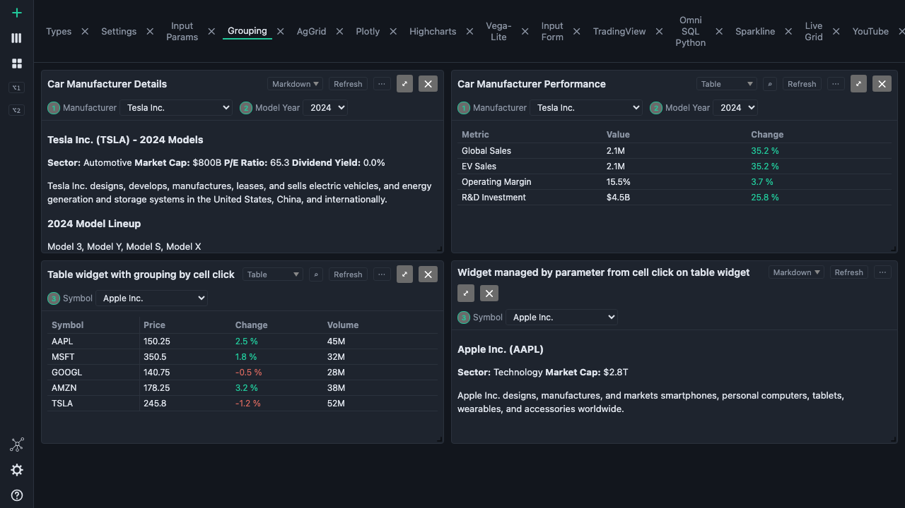

# BDOBB v3.0.0 — reference desktop

This is the clean release line for Adventures in OpenBQ Episode 3. It provides ordinary tables and charts, documents, backend Apps, linked parameter groups, Run/numeric refresh, and compatible dashboard exchange. Analytical Pivot belongs to v4; multi-dashboard workspaces and Statement belong to v5. Cron remains deferred.

## Connect and open the reference app

The reference backend must already be running. In **Connections**, choose **Connect Backend**, name it Reference, and enter its base URL. For the October 6 rehearsal this was `http://127.0.0.1:7780`; use the address of your own instance. Choose **Test**, then **Add**.

Choose **Apps** in the left rail, find **Onboarding App for Devs**, and choose **Open**. Its fourteen tabs and 69 cards become a local dashboard in the qualified curated reference. Other backend revisions may have different counts. Apps are ready-made dashboards supplied by a backend; opening one does not subscribe it to future backend changes. A connection can have working widgets even when it serves no apps.

If the name already exists, **Keep both** creates a numbered copy, **Replace** replaces the existing contents, **Skip** leaves it out, and **Cancel import** stops the import without writes. Replace is unavailable when more than one existing dashboard has that name.

A later analytical app may appear in a backend catalog. v3 refuses an unsupported analytical format before writing dashboards; use an ordinary v3-compatible app instead.

## Verify linked controls

Open **Grouping**. The manufacturer details and performance cards share Manufacturer and Model Year. Select Tesla in either Manufacturer control. Both controls should say Tesla; the details and performance data should change together. In the reference fixture, Tesla global sales are 2.1M. That is synthetic demonstration data.

The numbered badges show group membership. A cell in the company table can also change the linked Symbol group. To let a dashboard's cards operate independently, use **Disable grouping** on its dashboard-row menu; the groups remain saved and can be enabled again.

## Run and refresh

**Refresh** refetches one card. The tab's **↻** button or **⌘R** refreshes its mounted cards. A changed parameter clears the old answer while the new one loads; refreshing the same question keeps existing data visible.

A **Run** widget fetches initially, then uses **Run** to execute committed changes. Changing a parameter alone marks it stale. A numeric widget interval overrides the app-wide **Settings ▸ General ▸ Auto-refresh every** preference. `false` disables automatic refresh for that widget. Timers wait for completion and pause while the page is hidden. Cron-style schedules are unsupported in v3.

## Save and exchange dashboards

Dashboard edits save locally. For another machine, right-click a dashboard row:

- **Export BDOBB-compatible apps.json…** preserves dashboard/card names, tab order, parameter groups, and ordinary table sorting, filters, column order, hidden/pinned columns and transposed view.
- **Export OpenBB apps.json…** writes the plain OpenBB app shape. BDOBB-specific table and title state is omitted.

Import through **Import apps.json…** on the dashboard section menu, or drop the file onto the dashboard. Names use the same conflict choices as Apps. Missing widgets remain unresolved until a connected backend serves them. Imports refuse files over 10 MB or more than 500 dashboards before writing.

Neither dashboard export includes dropped-file bytes, backend credentials, or account passwords. Transfer a local data file separately. Settings and folders have a separate **Settings ▸ Export… / Import…** flow. Connections do not travel in that file.

## Optional Workspace preferences

**Workspace connections.**
- **Adding one.** **Connections ▸ Add Workspace** takes a name and an HTTPS server address (loopback HTTP for development); the sign-in dialog then takes a username or email, a password and **Remember me**. You can add several.
- **What is stored.** Only the name, the address and a remembered username are saved; passwords and session tokens never are.
- **Signing in.** Signing in may replace another Workspace session, and accounts requiring extra verification must complete it in Workspace first.
- **Settings API.** Data backend cards show **Settings API: key**, **login**, **key refused** or **no**.

**Ask for credentials on startup.** Every connection, Workspace or data backend, offers this option. At launch, one prompt walks the flagged connections:
- a Workspace connection asks for its username and password;
- a data backend asks for its Key and Value;
- **Remember me** decides whether the username or the value is stored.

**User Settings.** **Settings ▸ General ▸ User Settings** is **Local** or **Server**.
- **Choosing a server.** **Server** shows a dropdown of connections that serve the Workspace settings API, each labelled **key** (its own key and value authorise it) or **login** (a username and password). A data backend must use HTTPS. A login server's backend credential must not use the Authorization header.
- **Connecting.** Choosing a server connects to it, compares your settings with the server's, and asks **Use <connection>** or **Keep local** when they differ. After that, each save uploads.
- **At launch.** The settings server always connects first: by key without a prompt, or by login with the remembered username filled in. A flagged backend asks for its key and value first. Cancel keeps local settings for the run.
- **Errors and removal.** A refused key shows "Key refused by <connection name>; fix the key in Connections." in Settings, and the choice stays where it was; a connected key session that is later refused reads **Not synced: key refused**. Removing the server connection returns storage to Local.
- **HTTP Basic as the key.** A server may use HTTP Basic as its key (backend credential header `Authorization`, value `Basic ...`, as openbq-docker does). A 401 with a Basic challenge after a credential was sent means the key was refused (**Settings API: key refused**); a 401 without it means login.

Dashboards, backends and provider keys are not synchronized. Live account authentication remains unqualified.

## Help and troubleshooting

**Help ▸ Quick Help** gives short instructions for each surface; **Help ▸ Reference Manual** opens the longer task guide. Each has its own search box. **Settings ▸ Logs** shows recent errors.

If no apps appear, check whether the connection actually serves `apps.json`. If a card is unresolved, connect the backend that serves its widget. A deliberately failing reference example is an error-handling exercise, not proof that every endpoint must return data. External image/video examples still depend on their hosts.

## Measured qualification

On October 6, 2026 the fresh client passed a 71-widget curated reference rendering sweep, seven reference contract/import/export checks, linked Toyota→Tesla browser acceptance, and real Run/numeric-refresh request checks. A separate OpenBQ Docker smoke passed eight live-data tables plus a historical chart view. It covers nine selected cases, not all 995 advertised widgets.

Browser rehearsal used real backend responses with a test-only CORS adapter. Cron, live account authentication, and packaged native restart remain outside this qualification. Full regression and native bundle status are recorded in the release receipt; these reference passes alone do not announce a tagged release.

Copyright 2026 SecretoftheUniverse.com LLC. Licensed under Apache-2.0.

---

Copyright © 2026 SecretoftheUniverse.com LLC. Original documentation is separately restricted under the [Documentation Terms](https://github.com/Adventures-OpenBQ/bdobb/blob/v4.0.0/DOCUMENTATION_TERMS.md). Software, code examples, third-party licenses, and previously granted rights are excluded. Full terms are also included in Quick Help’s Getting started and the Reference Manual’s home page.
