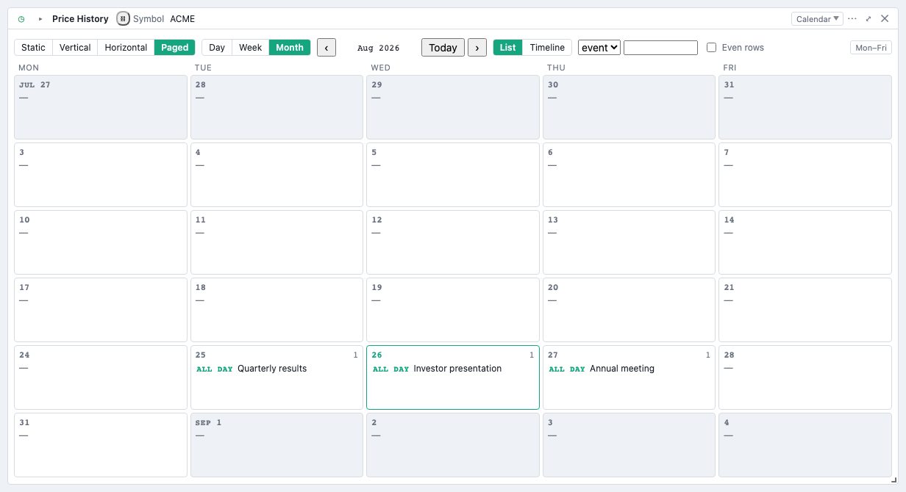
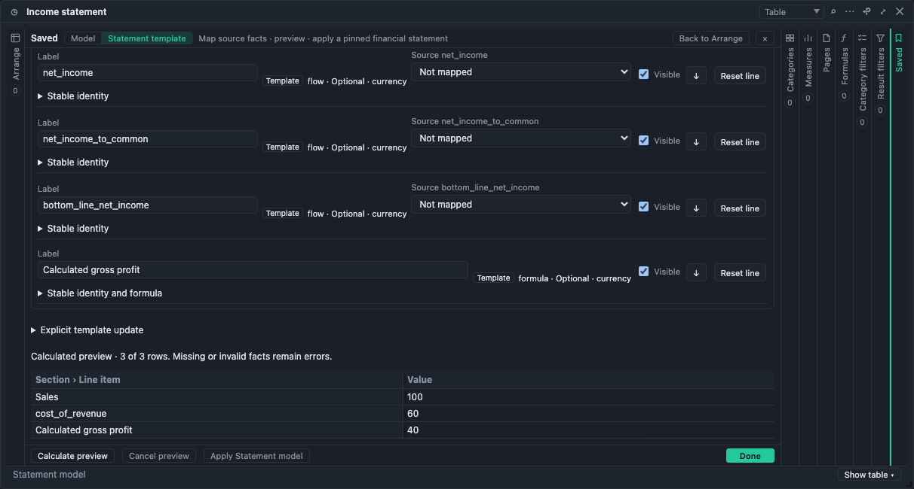

# BDOBB v4.0.0 — core tools and analytical tables

This local candidate builds on the qualified v3 reference desktop. It adds analytical tables, date expressions and exchange sessions, richer library/key controls, Calendar presentation and persistent parameter panels. Pinned Statement templates belong to v4 under Pivot → Saved → Statement template; Workspace layouts and generic Statement presentation belong to v5. Cron remains deferred.

## Start with the reference desktop

Connect an OpenBB-compatible backend in **Connections**, Test it, then Add. Open a supplied dashboard from **Apps** or add individual widgets from **Widget Library**. Apps and imported files ask **Keep both**, **Replace**, **Skip** or **Cancel import** when a dashboard name already exists. Escape cancels only the top conflict dialog. See the [v3 reference desktop manual](../v3/README.md) for ordinary groups, Run, numeric refresh, documents and onboarding.

## Build an analytical table

Open a table's **Pivot** drawer. Configure category rows and split columns, then add measures with independent aggregation choices. Two measures may use the same source column with different aggregations. Formula definitions and Page filters belong to the table's saved model; derived output is recalculated from its loaded input.

Sorting and filtering operate over loaded input, not only visible rows. Local and linked tables calculate in a worker and transfer bounded display blocks. Partial or sampled inputs remain partial: Pivot does not acquire missing data or promise unlimited file size. Check completeness and provider-aggregation hints before interpreting totals.

A table selection can be explicit or **all matching** with exclusions. Create a linked table or linked chart from a source to follow its presented input and selection. Linked cards retain their source relationship when saved and when exported through the v4 compatible format. Remove or change a source deliberately; a missing source should produce a diagnostic rather than unrelated data.

## Date expressions and trading calendars

Add the **Date expression** or **Period echo** built-in, or import `docs/examples/v4.0.0-parameters.apps.json`. Expressions resolve against their As of value; `T` means the current reference date and `T-5bd` moves back five business sessions. Choose the relevant exchange for session-aware expressions. Fiscal controls use the card's fiscal year-end month.

Trading-calendar coverage is finite. Dates outside supported exchange data use the documented fallback and warning behavior; check the in-app **Date Expressions** page for syntax, fiscal periods, closed-session rules and fallback details. Date and datetime controls have different precision; inspect the echoed request value before linking a group to production data.

## Keep parameters visible

Titlebar chips show parameter values. Open **Parameters** from the card menu or its chevron to dock the labeled controls beneath the titlebar. The panel stays open until you close it; clicking outside or Escape does not dismiss it. **Display on title bar** controls whether those values also appear as chips. Both choices save with the card and travel in a BDOBB-compatible v4 export.

## Calendar, library and keys

For a table with a date column, select **Calendar** in its **View** control. Choose its day/week/month presentation and date/title fields; saved cursor, weekdays and series/tree filters travel in compatible exports. Calendar is a presentation of available rows, not an additional data fetch.

Use the library's search and filter pills to narrow widgets and inspect which are already on the dashboard. Provider badges reflect available key checks. **Provider Keys** shows availability and a Details dialog; a configured credential and a successful probe are different states. Credentials remain backend/settings concerns and never enter dashboard exports.

## Save, reopen and exchange

Edits save locally. **Export BDOBB-compatible apps.json…** selects a v4 profile when the dashboard needs analytical definitions, symbolic selections, links, fiscal/calendar or dock state. Ordinary dashboards can still use the strict v3 profile. Import allocates fresh local card identities and remaps links to the corresponding imported cards, including across tabs.

Existing v3 files remain readable. Unknown profiles or malformed durable settings are refused before an import writes dashboards. The curated reference's supported `pivot-v1` layout overlay imports as the table's own Pivot settings, applied by the table itself; backend tables do not run on the in-app table worker. Do not assume another client or an older BDOBB understands this profile.

**Export OpenBB apps.json…** writes the plain OpenBB shape and omits BDOBB-specific state. Compatible exports do not bundle dropped-file bytes; a local-file dependency can be refused as `MISSING_LOCAL_ASSET`. Transfer files separately and verify the reopened dashboard. Credentials, passwords, runtime caches and worker results are not included.

## Settings and help

**Settings** supports System, Light and Dark appearance, layout spacing, staged preferences and text-log export. Done saves pending edits; Cancel discards them. **General ▸ User Settings** is Local or Server: Server syncs display settings with a Workspace connection or a backend serving the Workspace settings API (chosen in **Connections**, which also offers **Ask for credentials on startup** on every connection); it does not synchronize dashboards. Use **Help ▸ Quick Help** or **Reference Manual** for the complete controls and screenshot walkthrough.

## Qualification status

V3 is qualified and locally tagged. V4 is under regression and reference validation; no v4 tag or publication exists yet. This candidate manual describes the assembled behavior, not a claim that the final gates have passed.

Copyright 2026 SecretoftheUniverse.com LLC. Licensed under Apache-2.0.

The raw-table drawer opens on Arrange. Its first arrangement edit saves a report model; explicit Enable report model is in the Arrange footer. Saved combines Model inspection/repair and Statement template authoring. Use compatible export for validated model intent; plain apps exports omit it, and local file bytes require a repository archive. This integration candidate remains untagged.

## Reusable Statement templates

Choose **Pivot → Saved → Statement template**. Select Income statement, Balance sheet or Cash flow, map wide/long facts and fiscal evidence, then calculate a preview before applying. Snapshots remain version-pinned; updates require explicit comparison and repair. Flow, stock and formula rules retain missing/invalid facts as errors, and linked tables/charts use the same worker result without changing raw numeric values. Local labels, ordering, visibility and formula overrides persist with the saved definition.

[Light-theme preview](images/statement-preview-light.png). Both images come from actual guarded authoring tests with synthetic data. See in-app Tables for mapping, coverage, preview and update details.

Statement calculations require compatible company, currency and unit contexts across the facts actually used by a formula. Mixed contexts produce a cell error; they are never silently added or subtracted. Unrelated lines do not invalidate a formula. When fiscal evidence comes from source metadata, switching FY/FQ preserves that metadata binding. Explicit period fields still require the corresponding fiscal year, quarter and start/end bounds.

---

Copyright © 2026 SecretoftheUniverse.com LLC. Original documentation is separately restricted under the [Documentation Terms](https://github.com/Adventures-OpenBQ/bdobb/blob/v4.0.0/DOCUMENTATION_TERMS.md). Software, code examples, third-party licenses, and previously granted rights are excluded. Full terms are also included in Quick Help’s Getting started and the Reference Manual’s home page.
