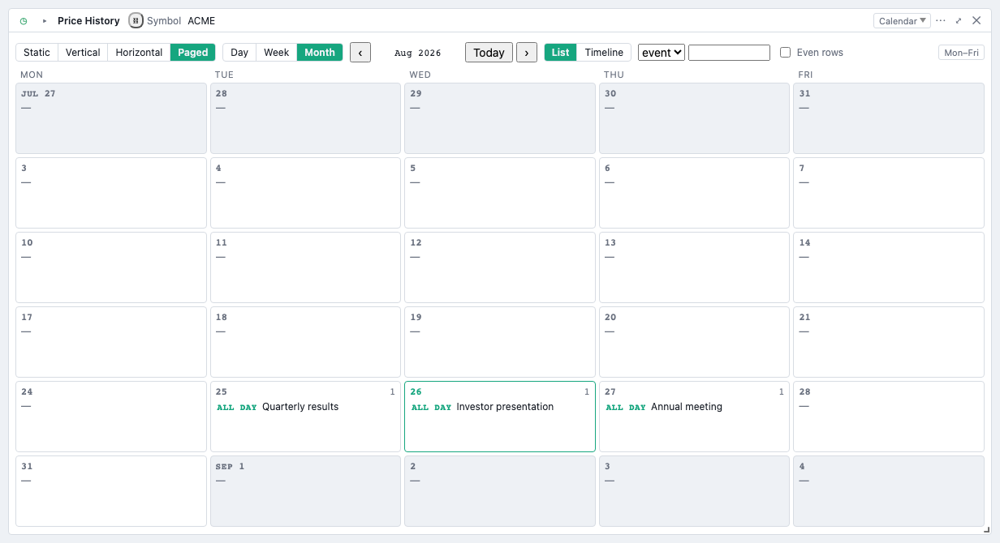
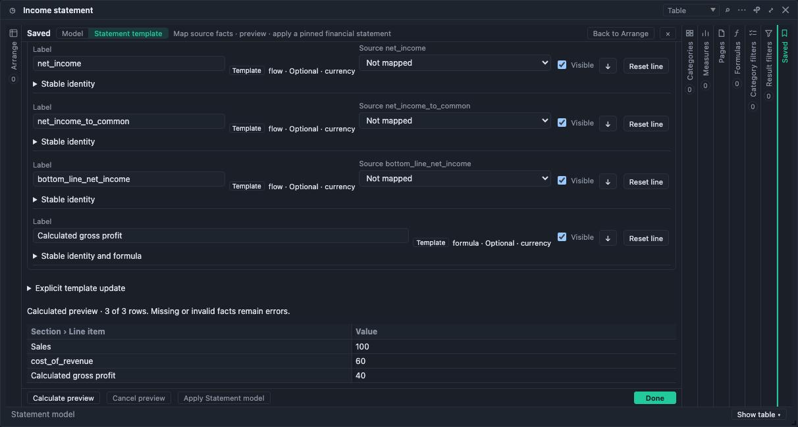

# BDOBB v4.0.0 — core tools and analytical tables

v4 builds on the [v3 reference desktop](../v3/README.md). It adds analytical Pivot models and pinned Statement templates, linked tables and charts, server-paged tables, date expressions with exchange calendars and fiscal periods, Calendar presentation, parameter rows and a docked Parameters panel, and richer library and key controls. In-app **Help ▸ Quick Help** and **Help ▸ Reference Manual** cover every control in detail.

## Start with the reference desktop

Connect an OpenBB-compatible backend in **Connections**, Test it, then Add. Open a supplied dashboard from **Apps** or add widgets from the **Widget Library**. When a dashboard name already exists, Apps and imports ask **Keep both** (the default), **Replace**, **Skip** or **Cancel import** before anything is written. The [v3 manual](../v3/README.md) covers groups, Run, refresh, documents and onboarding.

## Build an analytical table

Open a table's **Pivot** drawer from its header. Local, dropped-file, linked and backend tables up to 2,000,000 cells calculate in a worker; a larger backend table keeps the in-card panel and cannot feed linked widgets. The drawer's sections are **Arrange**, **Categories**, **Measures**, **Pages**, **Formulas**, **Category filters**, **Result filters** and **Saved** (with **Statement template**). The drawer opens on Arrange; its first arrangement edit saves a report model, and **Enable report model** is in the Arrange footer.

Measures choose an aggregation per data column, and two measures may aggregate the same column differently. Formula function names are accepted in any letter case. Sorting and filtering apply to the loaded input, not only visible rows. Partial or sampled inputs stay partial: Pivot never fetches missing data, so check completeness hints before reading totals.

## Linked tables and charts

**Create linked table** and **Create linked chart** on a table's **⋯** menu, or the Linked table and Linked chart entries in the library, add a card that follows a source table's presented rows and selection. **Choose source** relinks it. A missing source shows a diagnostic, never unrelated data, and when the source's scope is successfully empty the linked chart clears its figure.

## Server-paged tables

A widget its backend serves as an SSRM table opens as **LIVE · paged**: 100-row pages with **Previous page** and **Next page**, sorting by one column, and text-contains and number-range filters, all evaluated by the backend. The openbq-docker v4 stack serves its 41 largest datasets this way. LIVE paged tables cannot be linked-widget sources.

## Parameters, dates and calendars

A widget's parameters can be laid out in rows, as in OpenBB Workspace: row 0 shares the title line and each later row gets a line of its own. The **▸** chevron or **⋯ ▸ Parameters** docks the labeled controls under the title bar; the panel stays until you close it (Escape or a click outside does not dismiss it). **Display on title bar** turns a card's chips off. Both choices save with the card.

Date expressions resolve against an **As of** value: `T` is the reference date and `T-5bd` moves back five business sessions. A dashboard's **Exchange ▸** menu sets its calendar (**Default (XNYS)** otherwise). Without a backend calendar the app uses its bundled NYSE calendar for 2026–2028 and plain weekdays elsewhere, and says so with a badge. Fiscal controls use the symbol's fiscal year-end, falling back to December with a warning.

## Calendar, refresh, library and keys

Any card whose rows have a date column offers **Calendar** in its **View** control; it presents loaded rows and fetches nothing extra. The card's timer is its refresh button; a run-button card's marker pulses when parameters change. A widget's `refetchInterval` may be a number or a five-field cron expression. The library filters by search and pills and marks widgets already on the dashboard. **Provider API Keys** (when a backend runs key-maint) shows each provider's state; a configured key and a passing check are different states.

## Save, reopen and exchange

Edits save locally. A dashboard row's **Save… ▸** writes **Strict OpenBB Workspace** (the plain OpenBB shape) or **BDOBB Workspace**, which uses a versioned v4 profile when analytical models, selections, linked cards, fiscal and calendar choices or panel state need to travel. Import gives cards fresh identities and remaps links, including across tabs. v3 files remain readable; unknown profiles, malformed extensions and archived enabled Pivot state are refused before anything is written. The reference backend's `pivot-v1` layouts import as the table's own Pivot settings. Dropped-file bytes, credentials and caches never travel; a dropped-file table is refused as `MISSING_LOCAL_ASSET`.

## Reusable Statement templates

Choose **Pivot ▸ Saved ▸ Statement template**. Select Income statement, Balance sheet or Cash flow, map wide or long facts and fiscal evidence, then calculate a preview before applying. Snapshots stay version-pinned; updates need explicit comparison and repair. Missing or invalid facts stay visible as errors, and linked tables and charts use the same worker result without changing raw values.

[Light-theme preview](images/statement-preview-light.png). Both images come from guarded authoring tests with synthetic data.

Statement formulas need compatible company, currency and unit contexts across the facts they use; mixed contexts produce a cell error and are never silently combined. Explicit period fields need the matching fiscal year, quarter and start and end bounds.

## Settings and help

**Settings** offers System, Light and Dark appearance, layout spacing, staged edits (Done saves, Cancel discards) and text-log export. **General ▸ User Settings** is Local or Server; Server syncs display settings with a connection that serves the Workspace settings API, and dashboards too when that server offers them.

---

Copyright © 2026 SecretoftheUniverse.com LLC. Original documentation is separately restricted under the [Documentation Terms](https://github.com/Adventures-OpenBQ/bdobb/blob/v5.0.0/DOCUMENTATION_TERMS.md). Software, code examples, third-party licenses, and previously granted rights are excluded. Full terms are also included in Quick Help’s Getting started and the Reference Manual’s home page.
