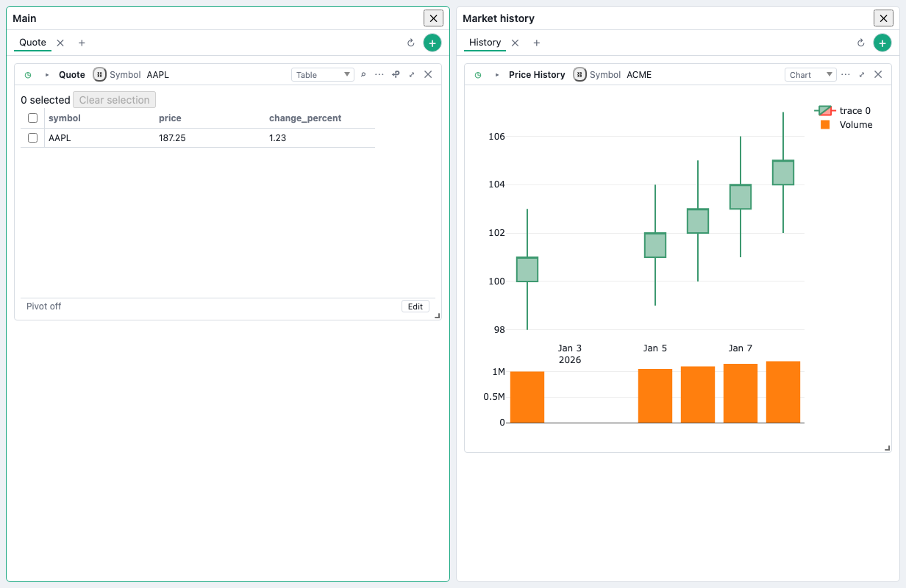
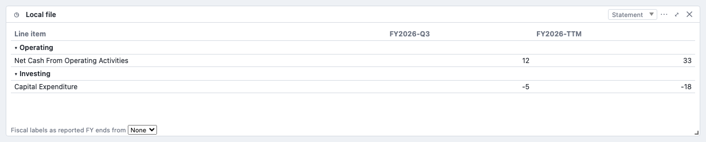

# BDOBB v5.0.0 — Workspaces and Statement

v5 builds on the [v4 core tools](../v4/README.md) and the [v3 reference desktop](../v3/README.md). It adds workspaces, which put several dashboards on screen together with saved layouts, a per-workspace minimum resolution and a choice of which one opens at launch, and the **Statement** view, which lays financial rows out as line items and relabels a statement's fiscal periods from each company's fiscal year end. It pairs with openbq-docker `v5.0.0`. In-app **Help ▸ Quick Help** and **Help ▸ Reference Manual** cover every control in detail.

## Workspaces

A workspace shows several existing dashboards at once, one per tile. A tile holds the dashboard itself, not a copy: each keeps its own tabs, cards and parameter controls, and an edit made in a workspace is there wherever that dashboard opens.

The **+** beside the rail's **Workspaces** heading, **New workspace…** on the rail's section menu, **File ▸ New Workspace…** in the desktop app and `⌥N` open the **Workspaces** dialog. Name the workspace, choose **Full Screen**, **Laptop** or a saved layout, then click a tile and a dashboard to fill it (or drag a dashboard onto a tile). **Save** keeps the dialog open; **Open** saves and switches to it; **Cancel** or Escape leaves nothing behind. Select a workspace in the rail to open it and click it again to return to a single dashboard. Its row menu offers **Edit…**, **Arrange…**, **Rename**, **Layout**, **Open at launch**, **Duplicate** and **Delete**; deleting a workspace never deletes its dashboards.

**Arrange…** puts a lettered face on each tile: drag to move, drag a corner to resize on a 12 × 12 grid, drop one tile on another to swap them, and **Add tile** fills the largest free space. **Done** saves; **Cancel** or Escape restores the arrangement. **Save layout as…** stores the geometry, not the dashboards, for reuse in any workspace.

[Dark-theme workspace](images/workspaces-dark.png).

## Screens, launch and the rail

A workspace's **Minimum resolution** is the smallest screen it is laid out for: **Any size**, one of your screens, a common size or **Custom…**. On a smaller screen it is laid out at that minimum and zoomed as a whole to fit, never above 100%. Tick **Open at launch** on several workspaces and BDOBB opens, at start-up, the ticked workspace with the largest minimum that fits the screen; if none fits, it opens a single dashboard as before.

In a workspace the rail can be pinned open with its lock or **Window ▸ Keep Sidebar Open**; each workspace remembers its own pin. **Settings ▸ Layout ▸ Option-number shortcuts** points `⌥1`–`⌥9` at **Dashboards** or **Workspaces**, and the rail's badges follow.

Workspaces and saved layouts are local files, one each. Dashboard exports do not include them, and **User Settings** on a server, which syncs display settings and, where the server offers it, dashboards, does not sync workspaces, layouts or dropped files.

## Statement view

**Statement** presents financial rows as line items in sections, one column per fiscal period. Choose it in a table card's **View** control when the rows contain recognized fields such as revenue, total assets or net cash from operating activities. Click a section heading to fold or reopen it; folds save with the card. **Table** shows the ordinary rows again, and Statement does not replace the Pivot model. Filters, search and the selected table scope decide which rows the Statement reads. Missing cells stay blank, zero stays zero and nothing is totalled that the data does not supply.

A backend statement widget, one whose **Period** offers FY and FQ, is relabelled from the reporting company's fiscal year end, asked of the card's backend per symbol: a January filer's quarter ending July 2026 reads `FY2027-Q2`, a December filer's quarter ending June 2026 `FY2026-Q2`. Table, charts and exports read the relabelled rows. A server table bound to such a widget is relabelled on the server, and a local CSV or XLS table from its rows' `fiscal_period` and `symbol` using the backend chosen under **FY ends from**. When a year end is unknown the rows stay as sent and the card says *Fiscal labels as reported*. Several companies in one table keep a column set each, prefixed with the symbol.

v4 Statement templates also show in this view with their own labels, order and formats; a calculation error shows and exports as `#ERROR`.

[Dark-theme Statement](images/statement-view-dark.png).

## Save, reopen and exchange

CSV, JSON and XLSX exports from a Statement contain every line item, folded sections included. A **BDOBB Workspace** save (**Save…** on a dashboard row) writes the v5 profile when a card uses Statement or has folds, nesting the v3 or v4 profile the rest of the dashboard needs, and its notice reads *Exported … with BDOBB v5 state.* A **Strict OpenBB Workspace** save omits the presentation. Import validates the profile before writing anything, gives cards fresh identities and remaps links; unknown versions and malformed or duplicate overlays are refused. Workspace arrangements, dropped-file bytes and credentials never travel in a dashboard file.

## Examples

openbq-docker v5 serves the earlier examples plus **V5 Statement Example**, a synthetic quarterly and TTM cash flow that needs no key, and *Example Dashboard - Version 5.0.0 - Treasury Auctions*, a Calendar of U.S. Treasury auctions on the API's own keyless Treasury widgets. The [synthetic financial demo](../../examples/v5-financial-demo/README.md) runs the Statement example from a local static backend.

---

Copyright © 2026 SecretoftheUniverse.com LLC. Original documentation is separately restricted under the [Documentation Terms](https://github.com/Adventures-OpenBQ/bdobb/blob/v5.0.0/DOCUMENTATION_TERMS.md). Software, code examples, third-party licenses, and previously granted rights are excluded. Full terms are also included in Quick Help’s Getting started and the Reference Manual’s home page.
