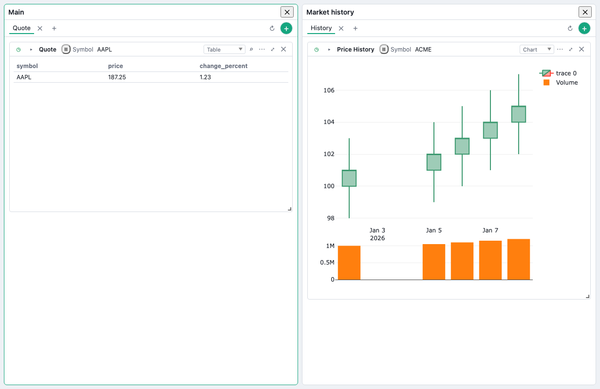
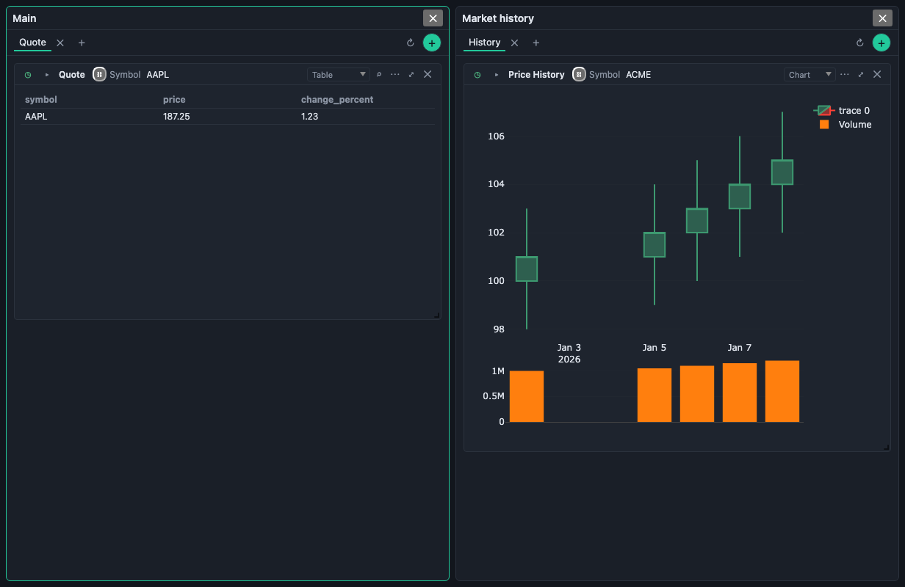
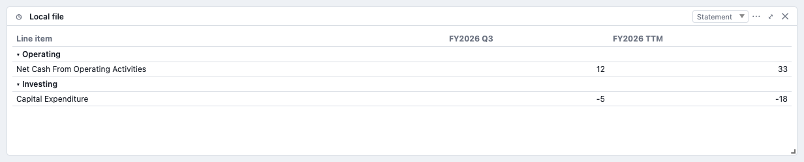
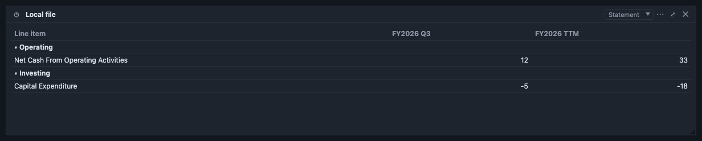

# v5 Reference Manual — Workspaces and Statement

This manual describes the isolated development candidate. Final v4 reconciliation and cumulative release qualification remain pending; no v5 tag is present.

V5 inherits the [v4 core controls](../v4/README.md) and the [v3 reference onboarding](../v3/README.md).

## Workspaces and Saved Layouts

A workspace puts several existing dashboards on screen together. Each panel keeps its own tabs, cards and parameter controls. Focusing one panel does not transfer its card edits to another dashboard.

Choose **New workspace** in the left rail, name it and choose **Full Screen** or **Laptop**. Assign dashboards to its slots. Select the workspace in the rail to open it; use its menu to edit or delete it. Removing a workspace does not delete its dashboards. A dashboard can also be opened on its own.

Use **Arrange** to resize and position panels or add a tile when room is available. **Done** commits the draft; **Cancel** or Escape discards it. **Save layout as…** stores reusable panel geometry, not dashboard data. Saving a layout is a separate action: Cancel after saving it still leaves that saved layout available. Applying a saved layout assigns geometry to a workspace; inspect which dashboards fill the resulting slots.

Workspace definitions and saved layouts persist locally. They are separate from dashboard apps.json exports. Optional User Settings storage on a server (Settings ▸ General ▸ User Settings) syncs display settings only; it does not synchronize these dashboards, workspaces, layouts or dropped files. A layout is an arrangement, not a copy of its panels' data.

## Statement View

**Statement** presents financial rows as line items grouped into sections, with a column for each fiscal period supplied by the data. Choose it in a supported table card's **View** control. Local and linked tables can offer the view; backend tables offer it when their rows contain recognized statement fields.

The rows need recognized financial fields such as revenue, total assets or net cash from operating activities. Period headers use the supplied fiscal year, period or date. TTM stays TTM; missing cells stay blank and zero stays zero. The view does not invent totals or convert one provider's fiscal calendar into another.

Click a section heading to collapse or reopen it. Those folds save with the card. Switch back to **Table** to inspect the ordinary rows; Statement does not replace the analytical Pivot model. Filters, search and selected table scope affect the worker rows used for the Statement. Review the underlying Table if those choices hide a needed period or financial field.

The view reads a completed worker result. During refresh it can retain completed data with a stale notice. Backend completeness may be unknown; that warning means a response is not proof of all available history. A table without recognized numeric line items shows an empty-state explanation.

CSV, JSON and XLSX exports from Statement use the completed line-item projection. Collapsing a section changes visibility, not the exported rows. **Export BDOBB-compatible apps.json…** preserves Statement and its folds using the v5 profile, together with inherited v4 settings. Plain OpenBB export omits that presentation. Compatible exports still do not bundle local-file bytes or credentials.

## Durable storage and exchange

The persistent store work associated with #339 continues to apply. Dashboard documents retain Statement folds, definitions, selections and links; workspaces have their own files under `workspaces/`, and saved arrangements under `layouts/`. A saved layout carries geometry without dashboard assignments. These documents are not worker-result caches.

BDOBB-compatible apps.json selects profile v5 when Statement state is present, nesting the applicable earlier profile. Imports validate that profile before writing, allocate fresh local card identities and remap inherited links. Unknown versions, malformed overlays and duplicate overlay positions are refused. Ordinary dashboards still use the appropriate earlier profile. An apps.json export does not bundle the workspace arrangement or local-file bytes. Portable preference bundles omit machine-local dashboard/workspace ordering IDs and do not synchronize data.

Section folds are durable presentation state; tab focus is session navigation state. Viewer edits retain their existing transient boundary. Credentials, runtime buffers and generated worker results do not become portable dashboard configuration.

## Verification boundaries

The development ledger records actual browser, worker, persistence and codec checks. Prior donor tests and copied v4 results do not qualify this candidate. User documentation must be rechecked after reconciliation with final v4. AI/Skills, widget pinning and provider-specific #342 activation are outside this v5 scope.

## Reproducible example

The [synthetic financial demo](../../examples/v5-financial-demo/README.md) includes a keyless static backend and compatible Apps manifest. Use it to verify supplied Q3/TTM labels, negative cash flow, folded-section exports and a two-dashboard workspace. Its values are test fixtures.

V4 Statement templates also work in this view. Their worker-calculated fiscal columns, authored section and line labels, order, and cell formats are preserved. The view shows only the producer’s presented or selected lines; it does not fill hidden lines or recalculate totals. A calculation error displays `#ERROR` with its reason on hover and exports as `#ERROR`, rather than a numeric value. Template section folds use stable identities, so renaming a section does not reopen it.

---

Copyright © 2026 SecretoftheUniverse.com LLC. Original documentation is separately restricted under the [Documentation Terms](https://github.com/Adventures-OpenBQ/bdobb/blob/v7.0.0/DOCUMENTATION_TERMS.md). Software, code examples, third-party licenses, and previously granted rights are excluded. Full terms are also included in Quick Help’s Getting started and the Reference Manual’s home page.
