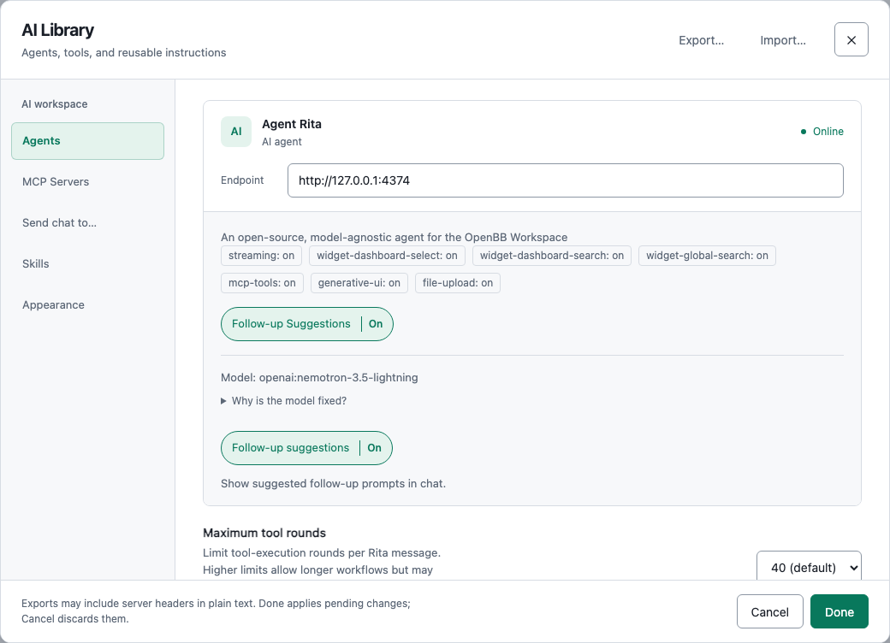
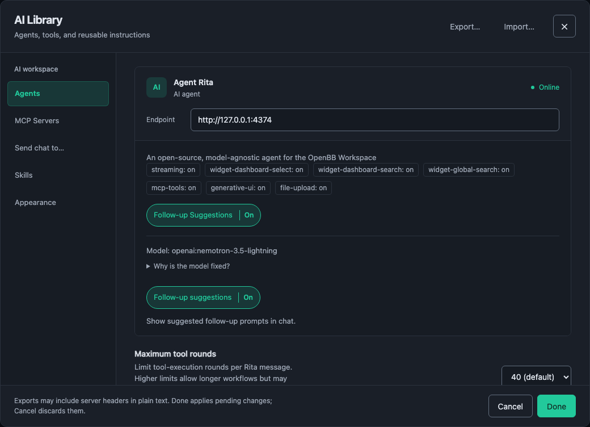
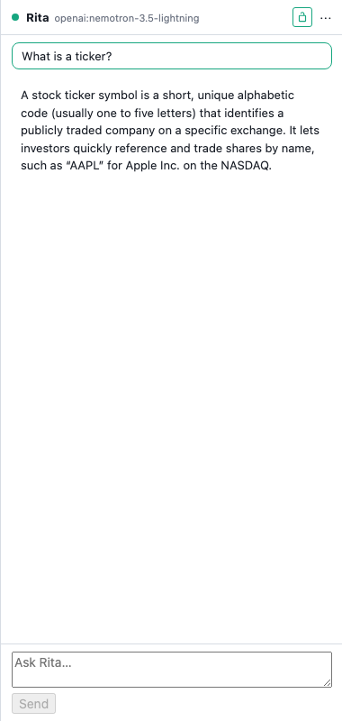
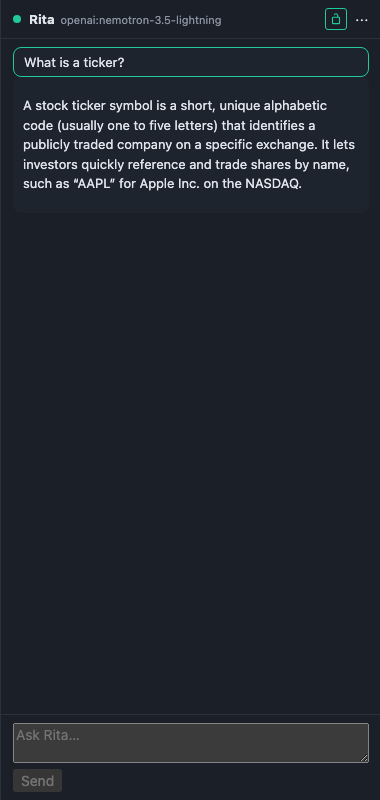

# v6 Reference Manual — Rita and the AI Library

This manual describes the isolated development candidate. Status: isolated development candidate; qualification pending; nothing published or tagged. Native migration and rollback were verified at file level only; see `docs/releases/validation/v6/native/migration.md` and the other receipts under `docs/releases/validation/v6/`.

V6 inherits the [v5 workspaces and Statement view](../v5/README.md), the [v4 core controls](../v4/README.md) and the [v3 reference onboarding](../v3/README.md). Everything below is off until you set it up: a fresh profile has no Rita URL and no MCP server, so nothing about your dashboards leaves the app.

## Rita setup

**Rita** is the chat agent. It speaks OpenBB's published custom-agent protocol; BDOBB fetches `agents.json` and posts conversations to `/v1/query`, both relative to the URL you give it. **MCP servers** are the tool services Rita can call for exact numbers. The reference deployment runs both on one tailnet node, published only to your tailnet:

| Service | Address |
|---|---|
| Rita | `https://<your-tailnet>:10443` |
| OpenBQ MCP | `https://<your-tailnet>:11443/mcp` |

`<your-tailnet>` stands for the full address of the node on your own tailnet; nothing in BDOBB or this manual names a real one. **Rita has no client authentication**: BDOBB sends no credential to Rita, and reachability on the tailnet is the whole of the access control.

Open the rail and click **AI Library**. On **Agents**, enter the Rita URL and press Return (or click away); the status reads *Not checked*, *Checking…*, *Online* or *Offline: reason*. *Online* means `agents.json` was fetched and parsed; it does not prove the model behind Rita is up. On **MCP Servers**, add the server URL and press **Check**, which performs the MCP handshake, lists the tools and reports the count (or *Unreachable*); it does not run a tool. Click **Done** to save: **Cancel**, the ✕ and Escape discard the draft. Once Done is clicked, a **Rita** tab appears on the right edge whenever a Rita URL is set.

A build can seed defaults from the optional `.env.local` variables `VITE_DEFAULT_RITA_URL` and `VITE_DEFAULT_MCP_URL` (the second adds one server named **OpenBQ MCP** with `install_skill` already switched off). They apply only to a setting the profile has never had; a URL you later clear is never reseeded.

## Chat and context sharing

Hover the **Rita** tab to open the pane (500 ms by default, 0 to 2 s in **AI Library ▸ Appearance**); lock it with ⌘⇧A (Ctrl+Shift+A on Windows and Linux) or the lock in the header. The header shows whether Rita is online and the model she will answer with; there is no model picker. Enter sends, Shift+Enter adds a line, and **Stop** aborts the turn (changes already made stay made and remain in the Undo bar; an MCP call already in flight runs to its own ten-second timeout). A request quiet for 45 seconds is abandoned; Rita's keepalive comments count as activity. The conversation is saved to `chat.json` in the app data directory; **Clear** deletes it.

**Context sharing** is a switch on the Agents tab, **off by default**. With it off, each message carries the conversation, the descriptions of your enabled skills, the list of tools Rita may call, your time zone, the agent's own option values, and one line naming the active dashboard and your other dashboards' names. No cards, parameters or data are sent. With it on, each message also carries a descriptor for every card on the active dashboard: id, widget, title, description, backend name, and each parameter's name, current value and default. That is the card's definition, not its data. A card's **⋯ ▸ Share with Rita** marks particular cards as added to context. Key-management and settings cards are never sent.

Rita gets data only by asking the app, which fetches rows over its own connection with its own credentials and the card's effective parameters, and only for a card on the active dashboard. Tool results and widget rows are not fenced off as untrusted data.

## Local tools

Rita acts on the app through **17 local tools**, run inside BDOBB under the reserved server name `bdobb-local`. Each takes a shallow object. Every tool that changes something adds an entry to the Undo bar; `search_widgets`, `describe_widget`, `describe_table` and `navigate` add none.

| Tool | Limits |
|---|---|
| `create_dashboard` | Name up to 60 characters; no key-management widget. Names match forgivingly; a miss returns suggestions. |
| `add_widget` | Current dashboard by default; no key-management or settings widget. |
| `search_widgets` | At most 50 results (20 by default); never returns a key-management widget. |
| `remove_widget` | Undo restores the whole card. Refused for a CSV/XLS table, because removal deletes its stored file. |
| `duplicate_widget` | Same dashboard only. |
| `describe_widget` | Read-only: parameters, types, current values, dropdown options. |
| `set_widget_params` | Only parameters the widget declares; a value outside a dropdown's options refuses the whole call. |
| `set_markdown_content` | Note and Markdown cards only; persisted text equals the tool input byte for byte. |
| `add_note` | Adds a Markdown card; never edits one. |
| `describe_table` | Read-only; CSV/XLS and linked tables only. |
| `arrange_table` | CSV/XLS and linked tables only; one Undo per call. |
| `move_widget` | The 40-column grid, same dashboard. |
| `rename_widget`, `rename_dashboard`, `rename_tab` | Card and tab on the current dashboard; `rename_dashboard` can name any dashboard. |
| `add_tab` | Current dashboard only. |
| `navigate` | Moves the view to a dashboard and/or tab by name; edits nothing. |

Rita can only name a card on the active dashboard. A key-management card is invisible to every tool: asked to touch one, a tool answers *unknown card*, as it would for an id that does not exist. `get_widget_data` is not one of the 17; it is how Rita asks the app for a card's rows, and a CSV/XLS table refuses it.

**Tool-round limit.** Each tool request is one round. **Agents ▸ Maximum tool rounds** sets how many one message may use: range 1–40, default 40, applied from the next message. At the limit BDOBB stops running tools, keeps the completed results, and ends with a **WARNING** that the work may be incomplete.

## Table model with Rita

`describe_table` and `arrange_table` drive the same shared table model and engine as the Pivot drawer. They apply to **CSV/XLS tables and linked tables** (a linked table computes only from its immediate presented source). A **backend table** answers `server-execution-pending` and nothing changes: backend tables are reserved for a later server-side executor. To arrange such data with Rita, load it as a CSV/XLS table; to read it, use `describe_widget` and `get_widget_data`.

- **The card's tab must be open.** Otherwise the tools answer `runtime-not-ready`; open the tab (or ask Rita to `navigate`) and ask again.
- `describe_table` returns a revision and `arrange_table` passes it back; a changed table answers `stale-revision` and Rita re-reads.
- An arrangement is all-or-nothing and adds **one Undo entry** per call. A call that changes nothing answers `unchanged` and adds none. A refused Undo shows its reason in the bar and is dropped so older entries stay undoable.
- A table with no stored model starts with no measures; Rita adds them before placing them.
- **Viewer scope.** In a viewer window Rita can change only the viewer controls the table already exposes, for that session only, with one Undo for just those controls; anything else is refused `viewer-scope`. The chat pane exists only in the main window, so this guard is rarely met.
- Every number Rita reports comes from the engine's preview of the applied result; the bundled **arrange-table** skill forbids totalling or averaging in the agent.

## MCP servers

The app speaks MCP's Streamable HTTP transport (`initialize`, `notifications/initialized`, `tools/list`, `tools/call`), follows tool-list pagination, and asks each enabled server for its tools at the start of a turn under a budget of 128,000 characters. Every MCP call carries a ten-second timeout. The reference server is `openbb-mcp-server` 2.0.1, which advertises ten tools; most real work goes through `call_tool` (one provider tool by name) and `run_pipeline` (several in order).

**There is no confirmation prompt.** A checked tool on an enabled server runs when the model calls it; you see it afterwards in the trail. The safeguards are which servers you enable and which tools you switch off.

**Per-tool disable works on effective names.** For `call_tool` the effective name is the call's `name` argument; for `run_pipeline`, every step's `tool`; otherwise the tool's own name. A call is refused before anything is sent if any effective name is switched off for that server, counted as a failure in the trail. A malformed proxy call is refused the same way. Unchecking `call_tool` or `run_pipeline` itself disables that proxy wholesale. **Tools called through proxies** lists names already called successfully through that server and lets you type a name to switch it off beforehand. Choices are staged until Done.

**Tokens.** A server marked **token** needs a bearer token. It is pasted in the row, kept only in `mcpTokens.json` in the app data directory, and never written to `settings.json` or to any export. A token is not sent to a server on a different host from its backend unless you turn on **Send credential anyway**. Servers arriving in an imported file arrive switched off. A server on this computer or a private network shows a warning but is not refused.

## Skills

A skill is a markdown file `skills/<slug>/SKILL.md` in the app data directory. Messages carry only the descriptions of enabled skills; Rita reads a body on request, and a disabled skill cannot be read. Five ship: **arrange-table**, **build-dashboard**, and OpenBB's `openbb-html-chart`, `openbb-html-report` and `openbb-html-table`. Create and edit them in **AI Library ▸ Skills**; `/skill:<slug>` at the start of a message forces one. The bundled skills are written only when `skills/` does not exist, so a profile upgraded from v5 receives them on first v6 launch. The library's Export and Import carry settings only, never skill files.

## Settings and rollback

New settings keys default to off or empty through `withDefaults`: Rita URL empty, Context sharing off, no MCP servers, 40 rounds. `chat.json`, `mcpTokens.json` and `skills/` are created on demand. `ai-library.json` carries the Rita URL, Context sharing, the MCP server list, share targets, the follow-up switch and the tool-round limit; `bdobb-settings.json` carries the same except the follow-up switch, plus the hover delay, per-agent answers, per-tool switches and proxied tool names. An import that omits a field keeps the current value.

**Rollback to v5.** v5 reads settings by spreading the loaded object, so it tolerates unknown settings keys. In the QA run a v5 binary left `skills/` and the two v6 settings keys (`ritaUrl`, `ritaMaxFunctionRounds`) untouched and ignored them. `chat.json`, `mcpTokens.json` and `ai-library.json` were never produced in that run, so that v5 ignores them is read from the code and not observed. Rollback is reinstalling the v5 build; no data is removed. File-level migration and rollback were verified on QA profiles; every GUI observation was BLOCKED (desktop control was unavailable), the settings keys were added by script, and the live native Rita session was not performed. Details: `docs/releases/validation/v6/native/migration.md`.

## Verification boundaries

The Part A and Part B gate receipts, including the live Rita and MCP runs against a tailnet node, are under `docs/releases/validation/v6/`. The live gate drives a language model and is not repeatable on demand; the receipts record each run. The final gates and the file-level migration and rollback receipts exist; native GUI verification and the native live Rita session do not, and the live gate passed only on an extra run after a failure. Donor test results do not qualify this candidate.
